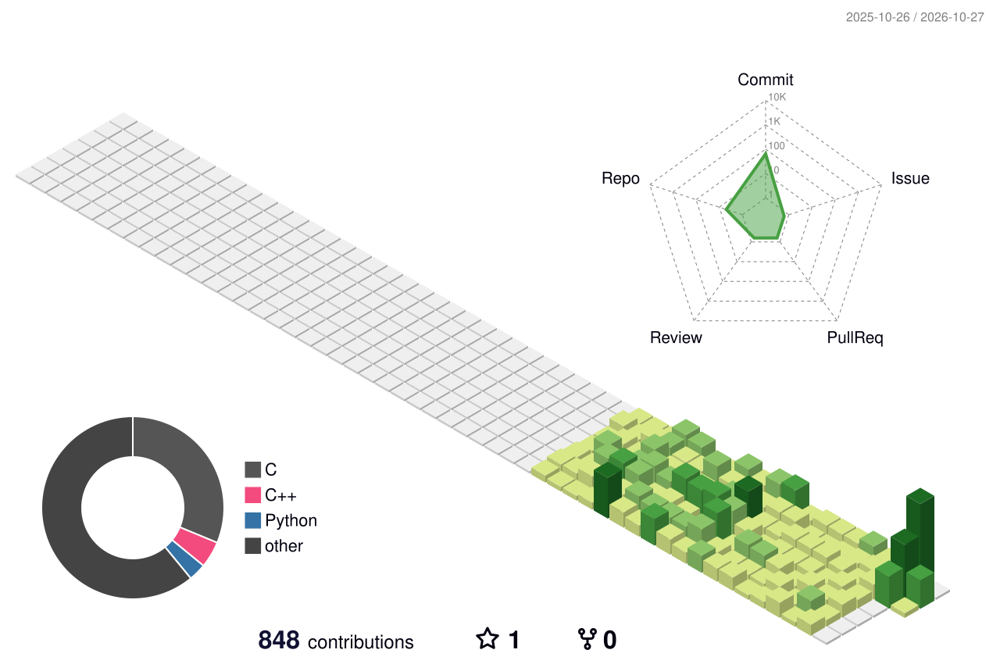

# Hi, I'm Blaze 👋

**Python · C/C++ · TinyML · Embedded software**

I've been working on small machine-learning models intended for microcontrollers. Most of the work so far is in Python: training models, testing them, and exporting them to C. Actual hardware benchmarks are still ahead.

  &nbsp;&nbsp;
  &nbsp;&nbsp;
  &nbsp;&nbsp;
  

### Current project — [ECG anomaly detection](https://github.com/bl4zeh3x/tinyml-explorations/tree/main/experiments/ecg-anomaly-detection)

An experiment in getting heartbeat classifiers small enough for embedded devices.

- Extracted **24 features per heartbeat**, including RR-interval timing.
- Compared three model sizes using a **patient-separated** train/test split.
- Exported the compact models to C and added tests that compare their predictions with Python.

The Edge model reached **82.95% accuracy and 0.409 macro F1** on held-out patients. It still struggles with some less common heartbeat classes; the per-class results are linked below.

[Code & tests](https://github.com/bl4zeh3x/tinyml-explorations/tree/main/experiments/ecg-anomaly-detection) · [Results](https://github.com/bl4zeh3x/tinyml-explorations/blob/main/experiments/ecg-anomaly-detection/results/summary.json) · [CI](https://github.com/bl4zeh3x/tinyml-explorations/actions/workflows/test.yml)

**Next:** run the exported models on real hardware and measure inference latency and memory usage.

I'm interested in internships, open-source contributions, and projects involving Python, ML tooling, or embedded software.

---

## 🛠️ Tech Stack

### Languages

  

### AI • Machine Learning • Computer Vision

  

  
  
  

### Development

  

### Operating Systems

  

### Engineering

  
  

### Currently Learning

  
  
  

